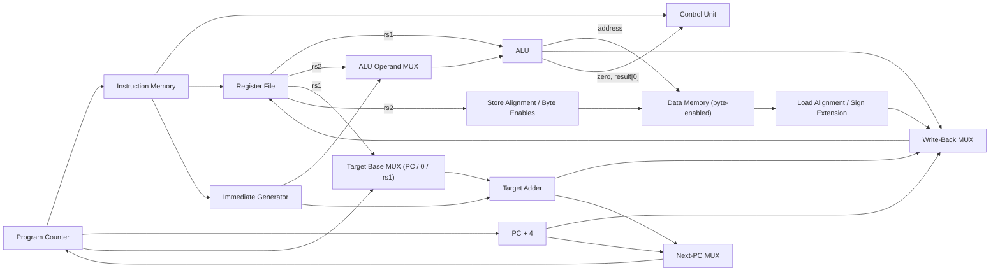

# RV32I Single-Cycle Processor

A single-cycle RISC-V processor core written from scratch in SystemVerilog, and verified with CocoTB and Verilator.

I built this over the summer of 2026, after my first year studying Electrical Engineering at Texas A&M, to learn how a CPU actually works by designing one end to end: from reading the ISA spec, to drawing the datapath, to writing the RTL, to proving it correct with a testbench.

| | |
|---|---|
| **ISA** | RV32I base integer (37 of 40 instructions) |
| **Microarchitecture** | Single-cycle, 32-bit, 32 general-purpose registers |
| **RTL** | 15 SystemVerilog modules, ~870 lines |
| **Verification** | 48 CocoTB tests: 11 module-level + 37 instruction-level (one per implemented instruction), simulated in Verilator |

---

## Architecture

Every instruction completes in one clock cycle: fetch, decode, execute, memory access, and write-back all happen between two rising edges.



### Modules

| Module | Role |
|---|---|
| `ProgramCounter` | 32-bit PC register with synchronous active-low reset |
| `InstructionMemory` | Word-addressed instruction ROM; also splits out rs1/rs2/rd fields |
| `ControlUnit` | Decodes opcode/funct3/funct7 into every datapath control signal, including branch resolution |
| `RegisterFile` | 32 × 32-bit registers, two combinational reads, one synchronous write, x0 hardwired to zero |
| `ImmediateGenerator` | Builds sign-extended immediates for the I, S, B, U, and J formats |
| `ALUMUX` | Selects register or immediate as the ALU's second operand |
| `ALU` | Add, sub, and, or, xor, sll, srl, sra, slt, sltu; outputs `zero` and the result's LSB for branching |
| `PC4Adder` | Computes PC + 4 for sequential fetch and link addresses |
| `MUXBranchAdder` | Shared target adder: base (PC, 0, or rs1) + immediate |
| `Decoder` | Store path: positions byte/halfword data and generates byte-enable bits |
| `DataMemory` | Word-addressed RAM with per-byte write enables |
| `ReadDataAlignment` | Load path: extracts the byte/halfword and sign- or zero-extends it |
| `WriteBackMUX` | Chooses ALU result, loaded data, PC + 4, or target-adder output for write-back |
| `PCSourceMUX` | Chooses PC + 4 or the computed target as the next PC |
| `SingleCycleProcessorCore` | Top level that wires the datapath together |


### Supported instructions (37)

| Type | Instructions |
|---|---|
| R-type (10) | `add` `sub` `sll` `slt` `sltu` `xor` `srl` `sra` `or` `and` |
| I-type ALU (9) | `addi` `slti` `sltiu` `xori` `ori` `andi` `slli` `srli` `srai` |
| Loads (5) | `lb` `lh` `lw` `lbu` `lhu` |
| Stores (3) | `sb` `sh` `sw` |
| Branches (6) | `beq` `bne` `blt` `bge` `bltu` `bgeu` |
| Jumps (2) | `jal` `jalr` |
| Upper immediate (2) | `lui` `auipc` |

Not implemented: `fence`, `ecall`, `ebreak` (they need memory-ordering and trap/exception support, which a bare single-cycle core without an OS doesn't use).

---

## Design decisions

**One adder for every non-sequential address.** Instead of separate hardware for branches, jumps, and upper-immediate instructions, a single adder computes `base + immediate`, where a 3-way MUX picks the base:
- `PC` for branches, `jal`, and `auipc`
- `rs1` for `jalr`
- `0` for `lui`

The same adder output feeds both the next-PC MUX and the write-back MUX, so `lui` and `auipc` reuse the jump hardware instead of adding a new datapath.

**Branches reuse the ALU instead of a separate comparator.** `beq`/`bne` subtract and check the `zero` flag. `blt`/`bge`/`bltu`/`bgeu` run `slt`/`sltu` and branch on the result's LSB, so signed and unsigned comparison come for free from logic that already exists.

**Sub-word memory access with byte enables.** Data memory is word-organized, so stores shift the byte or halfword into the correct lane and assert only the matching byte-enable bits, leaving the rest of the word untouched. Loads do the reverse: extract the correct lane using the low two address bits, then sign-extend (`lb`, `lh`) or zero-extend (`lbu`, `lhu`).

**x0 is enforced in two places.** The register file returns 0 whenever x0 is read and ignores writes to it, so x0 stays zero no matter what the control unit does.

---

## Verification

I verified the design bottom-up in two layers with [CocoTB](https://www.cocotb.org/) (Python testbenches) running on [Verilator](https://www.veripool.org/verilator/).

**1. Module-level tests (11).** Each major block was tested in isolation before integration: program counter (reset, load, hold between edges), instruction memory, control unit (control signals for every opcode), register file (x0 behavior, read/write), immediate generator (all five formats), ALU operand MUX, ALU (every operation), target adder (all three bases), data memory (byte-enabled writes), store alignment, and load alignment.

**2. Instruction-level tests (37).** Each implemented instruction gets its own test on the full core. Each test:
1. Starts a 10 ns clock and resets the CPU
2. Preloads source registers and data memory directly through the design hierarchy
3. Writes a hand-encoded 32-bit instruction into instruction memory
4. Advances one clock cycle
5. Asserts on the destination register, memory word, or PC

Branch tests check both the taken and not-taken outcomes, and jump tests check both the new PC and the saved link address.


### Running the tests

Requires Python 3, CocoTB (2.0+), and Verilator (5.x).

```bash
pip install cocotb
python Test_Benches.py
```

`Test_Benches.py` builds the RTL with Verilator and runs the tests through CocoTB's runner. The instruction-level tests target `SingleCycleProcessorCore`; to run a module-level test, change `hdl_toplevel` at the bottom of the file to that module's name.

---

## How I built it

**1. Learning the fundamentals.** Before writing any RTL, I studied how a single-cycle datapath works and read through the RV32I base ISA, focusing on the six instruction formats and how their immediates are encoded.
<!-- TODO: name your actual sources, e.g. the RISC-V ISA manual, Harris & Harris "Digital Design and Computer Architecture: RISC-V Edition", Patterson & Hennessy, a course, or video series -->
Main resources: RISC-V ISA manual, Fundamentals of Logic Design by Charles H Roth Jr, Microprocessor Architecture, Programming, and Applications by Gaonkar


**2. Designing on paper first.** I sketched the datapath and wrote a control-signal table for every opcode before coding, which is why the control unit is one flat decode of opcode → funct3 → funct7.

**3. Building and testing bottom-up.** I wrote each module, then a CocoTB test for it, and only moved on once it passed. Verilator's lint was strict and taught me a lot: it flagged an out-of-range address slice in instruction memory and incomplete `case` statements that would infer latches, so every decoder now has explicit defaults.

**4. Integrating and testing every instruction.** After wiring the core, I hand-encoded one test instruction per opcode in binary (each one annotated field by field in the testbench) and checked the architectural state after a single cycle.

### What I learned
- How each RV32I instruction maps onto datapath hardware and control signals, and how to share hardware between instructions instead of duplicating it
- Writing synthesizable SystemVerilog: `always_comb` vs. clocked logic, avoiding inferred latches, parameterized memories
- Verification methodology: unit tests before integration, and writing tests from the spec rather than from my own RTL
- The Verilator + CocoTB simulation workflow, from lint warnings to passing regression tests

---

## Limitations and next steps

- **Not yet implemented:** `fence`, `ecall`, `ebreak`, and traps for misaligned loads/stores
- **Memory:** 64-word instruction and data memories, enough for test programs but not a real application
- **Performance:** as with any single-cycle design, the clock period is set by the slowest instruction (a load, which passes through the ALU, data memory, and alignment logic in one cycle)

Planned:
- [ ] **5-stage pipeline** with forwarding and hazard detection
- [ ] Run C programs compiled with the RISC-V GCC toolchain, loaded via `$readmemh`
- [ ] Run the official [riscv-tests](https://github.com/riscv-software-src/riscv-tests) compliance suite
---

📧 sanmay.mangal@gmail.com · [LinkedIn](https://linkedin.com/in/sanmaymangal)
